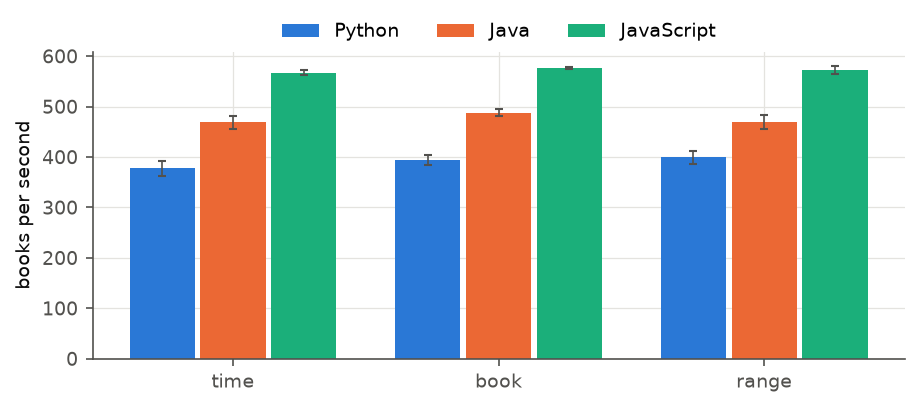
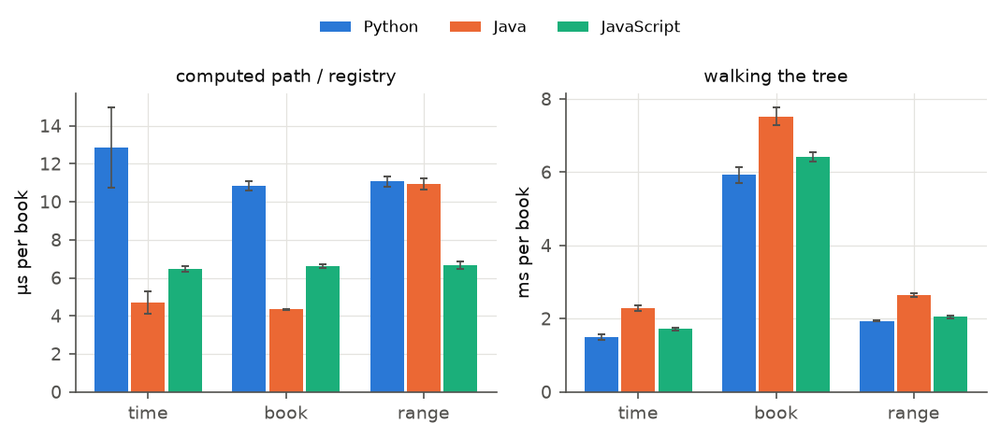
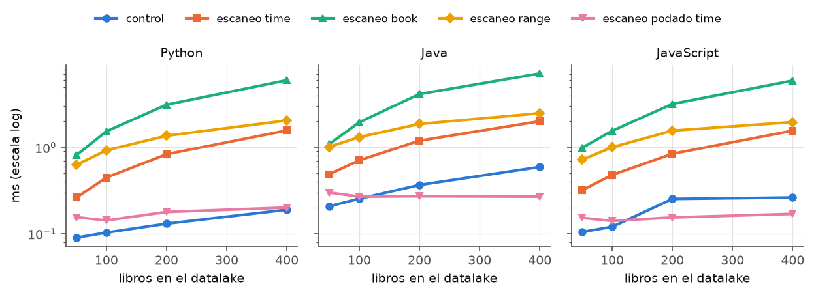
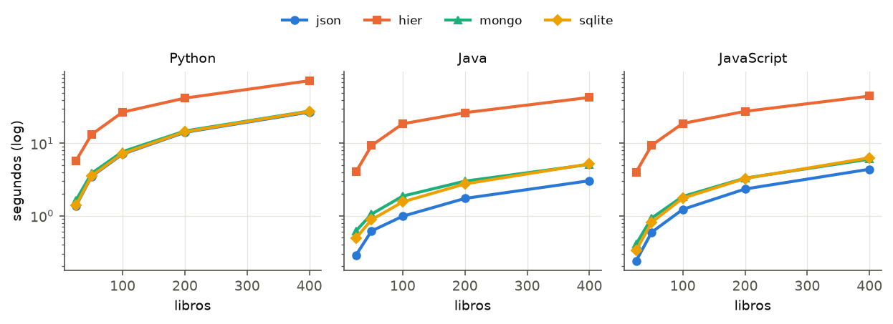
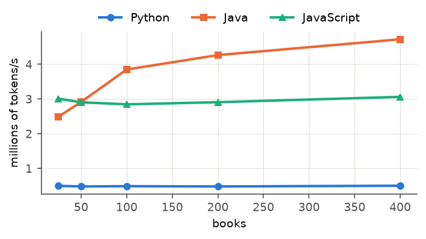
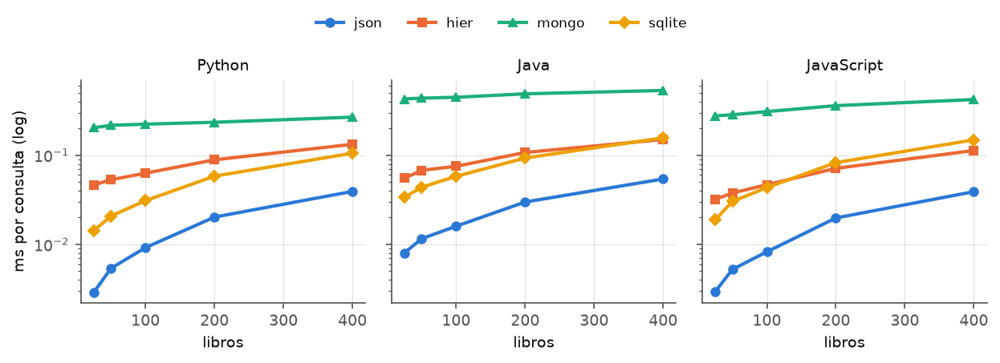
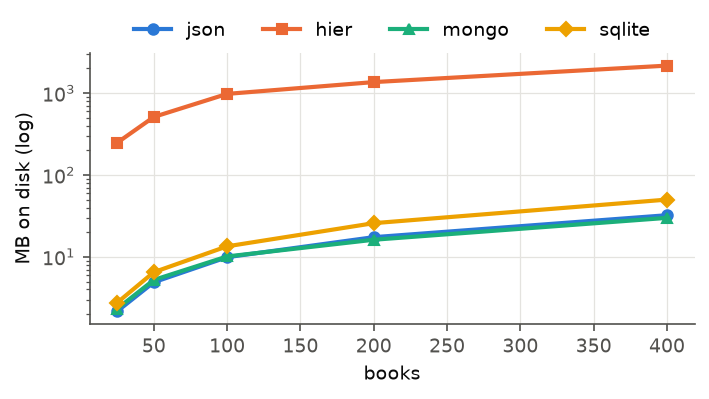

# 1. Introducción y objetivos

El proyecto de la asignatura consiste en construir desde cero un buscador de libros de Project
Gutenberg basado en un índice invertido. Esta primera fase se centra en la capa de datos, que es la
base sobre la que se apoyarán después la indexación, las consultas y los servicios. La capa de datos
separa dos tipos de almacenamiento: el **datalake**, que guarda el texto de los libros tal como llega
pero ya dividido en cabecera y cuerpo, y los **datamarts**, que guardan datos estructurados que se
pueden consultar: los metadatos de cada libro y el índice invertido. Por encima de ambos hay una
**capa de control** mínima que lleva la cuenta de qué se ha descargado y qué se ha indexado.

Los objetivos de esta fase han sido:

1. Descargar libros por identificador, separar cabecera, cuerpo y pie, y guardarlos de forma fiable,
   sin dar nunca por terminada una descarga que no se haya escrito entera.
2. Comparar tres formas de organizar el datalake (por fecha y hora, por libro y por rangos de
   identificadores) midiendo la escritura, el coste de localizar un libro, la detección de libros
   nuevos, la recuperación tras una interrupción y el espacio ocupado.
3. Extraer de la cabecera el título, el autor, el idioma y el año, y guardarlos en SQLite.
4. Construir el índice invertido y comparar cuatro estructuras: un fichero JSON, una carpeta con un
   fichero por término, MongoDB y una tabla de SQLite.
5. Implementar la capa de control que coordina descarga e indexación sin duplicar trabajo.
6. Hacer todo lo anterior en tres lenguajes (Python, Java y JavaScript) con exactamente las mismas
   reglas, para que la comparación mida el lenguaje y la estructura y no diferencias de funcionalidad.

El alcance es la capa de datos y su evaluación. La API REST y los servicios son de la segunda fase,
aunque varias decisiones se han tomado pensando ya en ella y se comentan en el texto.

# 2. Arquitectura del sistema

<figure>
<svg viewBox="0 0 720 350" xmlns="http://www.w3.org/2000/svg" font-family="Helvetica, Arial, sans-serif" font-size="11">
  <defs>
    <marker id="a" viewBox="0 0 10 10" refX="9" refY="5" markerWidth="7" markerHeight="7" orient="auto"><path d="M0,0 L10,5 L0,10 z" fill="#3a4a5e"/></marker>
  </defs>
  <rect x="10" y="20" width="130" height="48" rx="6" fill="#f3f4f6" stroke="#8a94a3"/>
  <text x="75" y="40" text-anchor="middle" font-weight="600">Project Gutenberg</text>
  <text x="75" y="56" text-anchor="middle" fill="#555">pg&lt;id&gt;.txt (HTTP)</text>

  <rect x="10" y="100" width="130" height="92" rx="6" fill="#e8f0fb" stroke="#2a78d6"/>
  <text x="75" y="120" text-anchor="middle" font-weight="600">Descarga</text>
  <text x="75" y="137" text-anchor="middle" fill="#333">timeouts, 3 intentos</text>
  <text x="75" y="152" text-anchor="middle" fill="#333">separar cabecera,</text>
  <text x="75" y="167" text-anchor="middle" fill="#333">cuerpo y pie</text>
  <text x="75" y="182" text-anchor="middle" fill="#333">tmp + rename</text>

  <rect x="190" y="100" width="190" height="92" rx="6" fill="#fdf0e9" stroke="#eb6834"/>
  <text x="285" y="120" text-anchor="middle" font-weight="600">Datalake</text>
  <text x="285" y="137" text-anchor="middle" fill="#333">time: YYYYMMDD/HH/&lt;id&gt;.*.txt</text>
  <text x="285" y="152" text-anchor="middle" fill="#333">book: &lt;id&gt;/header.txt, body.txt</text>
  <text x="285" y="167" text-anchor="middle" fill="#333">range: 001000/&lt;id&gt;.*.txt</text>
  <text x="285" y="182" text-anchor="middle" fill="#333">(+ _registry.tsv en time)</text>

  <rect x="190" y="230" width="190" height="88" rx="6" fill="#fff8e6" stroke="#eda100"/>
  <text x="285" y="250" text-anchor="middle" font-weight="600">Capa de control</text>
  <text x="285" y="266" text-anchor="middle" fill="#333">downloaded_books.txt</text>
  <text x="285" y="280" text-anchor="middle" fill="#333">indexed_books.txt, failed_books.txt</text>
  <text x="285" y="294" text-anchor="middle" fill="#333">1) ¿pendientes? indexar</text>
  <text x="285" y="308" text-anchor="middle" fill="#333">2) si no, descargar uno nuevo</text>

  <rect x="430" y="100" width="130" height="92" rx="6" fill="#e9f7f1" stroke="#1baf7a"/>
  <text x="495" y="120" text-anchor="middle" font-weight="600">Indexador</text>
  <text x="495" y="137" text-anchor="middle" fill="#333">metadatos (cabecera)</text>
  <text x="495" y="152" text-anchor="middle" fill="#333">tokenizador</text>
  <text x="495" y="167" text-anchor="middle" fill="#333">término → {id: tf}</text>

  <rect x="600" y="80" width="110" height="132" rx="6" fill="#efeefb" stroke="#6250d6"/>
  <text x="655" y="100" text-anchor="middle" font-weight="600">Datamarts</text>
  <text x="655" y="118" text-anchor="middle" fill="#333">metadata.db</text>
  <text x="655" y="136" text-anchor="middle" fill="#333">índice:</text>
  <text x="655" y="151" text-anchor="middle" fill="#333">json · hier</text>
  <text x="655" y="166" text-anchor="middle" fill="#333">mongo · sqlite</text>
  <text x="655" y="190" text-anchor="middle" fill="#555" font-size="10">build / add / postings</text>

  <rect x="600" y="240" width="110" height="50" rx="6" fill="#f3f4f6" stroke="#8a94a3"/>
  <text x="655" y="260" text-anchor="middle" font-weight="600">Consulta</text>
  <text x="655" y="276" text-anchor="middle" fill="#333">AND + metadatos</text>

  <line x1="75" y1="68" x2="75" y2="98" stroke="#3a4a5e" stroke-width="1.5" marker-end="url(#a)"/>
  <line x1="140" y1="146" x2="188" y2="146" stroke="#3a4a5e" stroke-width="1.5" marker-end="url(#a)"/>
  <line x1="380" y1="146" x2="428" y2="146" stroke="#3a4a5e" stroke-width="1.5" marker-end="url(#a)"/>
  <line x1="560" y1="146" x2="598" y2="146" stroke="#3a4a5e" stroke-width="1.5" marker-end="url(#a)"/>
  <line x1="655" y1="212" x2="655" y2="238" stroke="#3a4a5e" stroke-width="1.5" marker-end="url(#a)"/>
  <path d="M190,260 C120,260 75,230 75,194" fill="none" stroke="#8a6d00" stroke-width="1.3" stroke-dasharray="5 3" marker-end="url(#a)"/>
  <path d="M380,260 C460,260 495,230 495,194" fill="none" stroke="#8a6d00" stroke-width="1.3" stroke-dasharray="5 3" marker-end="url(#a)"/>
  <text x="96" y="284" fill="#8a6d00" font-size="10">descargar id</text>
  <text x="402" y="284" fill="#8a6d00" font-size="10">indexar id</text>
  <text x="360" y="343" text-anchor="middle" fill="#333" font-size="10.5">Implementado tres veces con las mismas reglas: Python 3.12 · Java 17 · JavaScript (Node.js 24)</text>
</svg>
</figure>
<p class="caption">Figura 1. Arquitectura de la capa de datos. Flechas continuas: flujo de datos. Discontinuas: decisiones de la capa de control.</p>

El recorrido de un libro es el siguiente. El crawler descarga `pg<id>.txt`, normaliza los saltos de
línea y separa la cabecera (metadatos y licencia), el cuerpo y el pie con los marcadores
`*** START/END OF THE PROJECT GUTENBERG EBOOK`. Cabecera y cuerpo se escriben en el datalake primero
como ficheros temporales y después se renombran; solo cuando los dos renombrados han terminado se
anota el identificador en `control/downloaded_books.txt`. El indexador coge de la capa de control los
libros descargados y aún no indexados, extrae los metadatos de la cabecera a `datamarts/metadata.db`,
tokeniza el cuerpo y añade sus términos al índice invertido. Al terminar anota el libro en
`control/indexed_books.txt`. Las consultas cruzan las listas de libros de cada término y completan el
resultado con los metadatos.

La capa de control sigue la lógica del enunciado: si hay libros descargados y sin indexar, indexa el
de menor identificador; si no, coge el siguiente candidato que no esté descargado ni haya fallado antes
y lo descarga. Los identificadores que fallan (no existen o no tienen marcadores) se apuntan en
`control/failed_books.txt` con el motivo, para no reintentarlos una y otra vez. Al arrancar se hace una
reconciliación: se borran los temporales y las mitades sueltas de una escritura cortada, se añaden al
control los libros completos que no estaban anotados y se quitan los anotados cuyos ficheros ya no
existen.

```
data/
  datalake/    001000/1342.header.txt, 1342.body.txt      (layout range)
  datamarts/   metadata.db
               inverted_index.json            (json)
               inverted_index/<A-Z|_>/*.txt   (hier)
               inverted_index.db              (sqlite; mongo usa la base searchengine)
  control/     downloaded_books.txt, indexed_books.txt, failed_books.txt
```

Las tres implementaciones siguen un mismo documento de reglas (`spec/pipeline_spec.md`) y leen los
mismos ficheros: lista de stop words, tabla de códigos de idioma, consultas de prueba y lista de
identificadores del corpus. Las tres tienen los mismos comandos (`pipeline`, `search`, `ingest`,
`bench-datalake`, `bench-index` y `canonical`) con las mismas opciones, de forma que el orquestador de
los benchmarks puede tratarlas como cajas negras intercambiables.

# 3. Decisiones de diseño

## 3.1. Descarga y separación de cabecera y cuerpo

La descarga usa la URL del enunciado (`https://www.gutenberg.org/cache/epub/<id>/pg<id>.txt`) con un
User-Agent propio, 10 s de timeout para conectar y 30 s para leer, y hasta 3 intentos con espera de
1 s y 2 s si hay error de red, HTTP 5xx o 429. Un 404 significa que el libro no existe y no se
reintenta. Si la respuesta trae `Content-Length` y no coincide con los bytes recibidos, la descarga se
considera incompleta y se repite. El texto se decodifica como UTF-8 y se quita el BOM.

Los marcadores se buscan con una expresión regular que acepta las variantes que aparecen en el corpus
(THE/THIS, EBOOK/E-BOOK, con o sin espacio después de los asteriscos) y solo al principio de una línea.
Así, una línea de asteriscos dentro del texto no se confunde con el final. El marcador de fin solo se
busca después del de inicio. Si falta alguno, el libro se rechaza (`no_markers`) y no entra en el
datalake. Para que los tres lenguajes den lo mismo, al recortar solo se quitan espacios ASCII: el
`trim()` de JavaScript quita también el espacio no separable y el `strip()` de Python otros espacios
Unicode, y eso cambiaba la salida.

Para no cargar el servidor de Gutenberg, el corpus de los benchmarks se descargó una sola vez a una
caché local con 1 s de pausa entre peticiones (`scripts/download_corpus.py`). Los candidatos son una
muestra con semilla fija de los identificadores 1 a 75 000. Se descartaron 7 (4 no existían y 3 no
tenían marcadores) y se quedaron los 400 primeros válidos: 143 MB en 14 idiomas, el 81 % en inglés.
Los benchmarks leen de esa caché (`--source cache:`) o de un espejo HTTP local con las mismas rutas
(`benchmarks/mirror_server.py`), que permite probar el cliente HTTP real de cada lenguaje sin depender
de Internet.

## 3.2. Organización del datalake

Se han implementado las tres organizaciones que propone el enunciado, todas con la misma regla de
escritura:

| layout | ruta | cómo se localiza un libro | estructura auxiliar |
|---|---|---|---|
| `time` | `YYYYMMDD/HH/<id>.header.txt` (hora UTC de la escritura) | hay que saber cuándo se descargó | `_registry.tsv` (id → partición) |
| `book` | `<id>/header.txt`, `<id>/body.txt` | ruta calculada a partir del id | ninguna |
| `range` | `<bucket>/<id>.header.txt` con bucket = ⌊id/1000⌋·1000 (`001000`) | ruta calculada a partir del id | ninguna |

En el layout `time` la ruta depende del momento de la descarga y no del identificador, por eso hace
falta un registro para encontrar un libro sin recorrer todo el árbol. Además, un benchmark hace en
segundos lo que un crawler real haría en días: con el reloj real todos los libros caerían en la misma
carpeta horaria y el layout perdería justo lo que lo caracteriza. Por eso en el benchmark se usa un
reloj sintético de 10 libros por hora (40 particiones para 400 libros); el pipeline normal usa el reloj
del sistema.

**Recuperación.** Cada libro se escribe así: cuerpo a `.tmp`, cabecera a `.tmp`, renombrar el cuerpo,
renombrar la cabecera y, al final, anotarlo en el control. Si el proceso muere, como mucho queda un
libro a medias, que la reconciliación detecta y limpia. Para medirlo se provocan dos tipos de caída
(entre los dos renombrados, y después de renombrar pero antes de anotar en el control) y se reanuda con
el reloj 24 horas más tarde, como si el proceso se hubiera vuelto a lanzar al día siguiente.

## 3.3. Metadatos

La cabecera se lee línea a línea. Una línea `Nombre: valor` abre un campo y las líneas que empiezan
por espacio lo continúan (por ejemplo, `Most recently updated` debajo de `Release date`). Se sacan el
título, todos los autores (unidos con `; `), el idioma (el primero si hay varios, pasado a código ISO
639 con una tabla), el año de publicación original (el último año del campo `Original publication`) y
el año de publicación en Gutenberg (el primer año de `Release date`). Se guardan por separado porque
responden a preguntas distintas: en el corpus solo 59 de las 400 cabeceras traen el año original,
mientras que todas traen la fecha de publicación en Gutenberg (y 377 tienen autor). Si un dato no está se guarda
`NULL` y nunca se rellena con otro campo. La tabla `books` de SQLite usa `book_id` como clave
primaria e `INSERT OR REPLACE`, así que reindexar un libro no lo duplica. También guarda la ruta de los
dos ficheros en el datalake, para poder localizar el texto a partir de los metadatos.

## 3.4. Tokenizador y modelo del índice

Las reglas son: pasar a minúsculas con el mapeo Unicode por defecto, sacar las secuencias máximas de
letras Unicode (`\p{L}`), quedarse con las de al menos dos caracteres y quitar 156 stop words en inglés.
El módulo `re` de Python no tiene `\p{L}`, así que la clase de caracteres se construye con
`unicodedata`; en JavaScript hace falta la bandera `u`, y en Java se usa `Character.isLetter`. La
longitud se cuenta en caracteres Unicode y no en unidades UTF-16, que en Java y JavaScript no es lo
mismo para letras fuera del plano básico. La lista de stop words es solo en inglés: una lista que
mezclara idiomas quitaría palabras con significado en otro idioma (`die`, `son`), y el 81 % del corpus
está en inglés. Usar listas por idioma queda como mejora.

El índice es de nivel de palabra con frecuencias: para cada término se guarda `{book_id: tf}`. La
frecuencia permitirá ordenar los resultados por relevancia en la fase 2. Las posiciones se descartaron
porque multiplicarían el tamaño del índice por el número medio de apariciones de cada término en cada
libro (unos 5 en este corpus) y ninguna operación de esta fase las necesita.

## 3.5. Estructuras del índice invertido

Las cuatro estructuras tienen la misma interfaz (construir, añadir un libro y obtener las postings de
un término), de forma que el benchmark ejecuta exactamente el mismo código para todas:

| estructura | formato | añadir un libro |
|---|---|---|
| JSON | `datamarts/inverted_index.json`: `{"término": {"id": tf}}` | cargar, fusionar y reescribir el fichero entero (temporal + renombrado) |
| Carpetas (`hier`) | `inverted_index/<A-Z\|_>/<término>.txt` con líneas `id<TAB>tf` | añadir una línea al fichero de cada término del libro |
| MongoDB | un documento por término: `{_id: término, postings: {"id": tf}}` | `updateOne` con `$set postings.<id>` y `upsert`, en lote no ordenado |
| SQLite | `postings(term, book_id, tf)`, clave `(term, book_id)`, `WITHOUT ROWID` | `INSERT OR REPLACE` en una transacción |

JSON, carpetas y MongoDB son las tres que propone el enunciado; SQLite es la estructura propia que se
añade, porque los metadatos ya están en SQLite y era la candidata natural para la fase 2. Las cuatro
aguantan que se reindexe un libro. La de carpetas solo añade líneas, así que la idempotencia se
consigue al leer: si un libro aparece varias veces en un fichero, vale la última línea.

La estructura de carpetas tuvo dos problemas que el enunciado no menciona. `con.txt`, `nul.txt` o
`aux.txt` son nombres reservados en Windows (y `con` es una palabra real), y los sistemas de ficheros
de Windows y de macOS no distinguen mayúsculas de minúsculas por defecto, así que términos griegos
como `οδος` y `οδοσ` podían chocar. Los nombres de fichero dejan tal cual las letras a-z y codifican
cualquier otro carácter como `%XX` (bytes UTF-8); a los nombres reservados se les añade `_`.

## 3.6. Lenguajes y equivalencia

Se han elegido Python 3.12 (el lenguaje de los ejemplos del enunciado), Java 17 (el de los servicios de
la fase 2, así que parte del código se reutiliza) y JavaScript sobre Node.js 24, que el enunciado cita
y que tiene un modelo de ejecución diferente (motor V8 con compilación JIT). C# se descartó porque no
aportaba nada distinto de Java.

Que tres implementaciones «sigan las mismas reglas» hay que comprobarlo. El comando `canonical`
construye metadatos e índice (55 libros de golpe y 5 añadidos uno a uno) y exporta una salida en un
formato fijo, y la campaña `equivalence` la compara. Las 12 combinaciones de lenguaje y estructura dan
exactamente los mismos 60 registros de metadatos y las mismas 165 479 listas de términos (mismo resumen
SHA-256, ver `benchmarks/results/equivalence.txt`). Además, en todos los benchmarks se comprueba que
las 20 consultas devuelven los mismos libros en todos los lenguajes y estructuras. Por el camino
hubo que corregir varias diferencias sutiles:

- La bandera `m` de las expresiones regulares de JavaScript también trata `U+2028` como fin de línea,
  así que el texto se recorre línea a línea separando solo por `\n`.
- `JSON.parse` reordena las claves que parecen números, y un objeto normal de JavaScript resuelve
  términos como `constructor` contra su prototipo. El índice JSON de JavaScript usa `Map` y un lector
  propio.
- El decodificador UTF-8 de Java sustituye una secuencia inválida por un solo `U+FFFD` donde Python
  pone tres. Java usa un decodificador pequeño propio cuando aparece ese carácter.
- Las salidas se ordenan por punto de código, porque el orden de `String.compareTo` en Java y el de
  `sort()` en JavaScript (UTF-16) es distinto para caracteres fuera del plano básico.

Queda una diferencia que no se puede evitar: cada lenguaje trae su versión de Unicode (13 en Java 17,
15 en Python 3.12 y 17 en Node 24), así que unos pocos miles de letras añadidas en los últimos años solo
cuentan como letras en algunos lenguajes. Ninguna aparece en el corpus.

## 3.7. Metodología de los experimentos

| Elemento | Valor |
|---|---|
| Equipo | Apple M3 (8 núcleos: 4 de rendimiento y 4 de eficiencia), 8 GB de RAM, SSD interno con APFS |
| Sistema operativo | macOS 26.3.1 (arm64) |
| Entornos | Python 3.12.13 (SQLite 3.53); OpenJDK 17.0.21 (Temurin) con `-Xms256m -Xmx3g`; Node.js 24.15 con `--max-old-space-size=3072`; MongoDB 7.0.14 local con 1 GB de caché |
| Corpus | 400 libros (143 MB), siempre en el mismo orden; subconjuntos de 25 a 400 libros |
| Repeticiones | datalake 5, recuperación 3, espejo HTTP 3, índice 3; orden intercalado (repetición → tamaño → estructura → lenguaje) |
| Aislamiento | cada configuración en un proceso nuevo y con la carpeta de trabajo vacía |
| Tiempos | reloj monotónico dentro de cada programa (`perf_counter`, `nanoTime`, `hrtime`) |
| Memoria | pico de memoria residente del proceso, muestreado cada 20 ms desde fuera con psutil (igual para los tres lenguajes); con MongoDB también la del servidor `mongod` |
| Disco | bytes de los ficheros y bytes asignados en disco; para MongoDB, `storageSize + totalIndexSize` después de un `fsync` |

Hay que tener en cuenta dos cosas. Primero, todas las ejecuciones encuentran los ficheros en la caché
del sistema operativo porque se acaban de escribir o de leer: se mide el coste con la caché caliente,
que es el caso normal de un servicio en marcha. Segundo, el pico de memoria de Java refleja sobre todo
cómo gestiona la JVM su heap (con un máximo de 3 GB devuelve la memoria tarde); no es la memoria mínima
que necesita el programa. Con solo 8 GB de RAM en el equipo, los límites de heap se ajustaron para que
ninguna ejecución tuviera que usar memoria de intercambio.

# 4. Benchmarks y resultados

Todas las cifras son la media ± la desviación típica de las repeticiones. Los CSV de cada ejecución
están en `benchmarks/results/raw/` y `benchmarks/analyze.py` genera a partir de ellos las tablas
completas (`benchmarks/results/tables.md`) y las figuras. Aquí se muestran las más importantes.

## 4.1. Datalake

### Escritura

| lenguaje | time (libros/s) | book (libros/s) | range (libros/s) | MB/s (range) | pico RAM (MB) |
|---|---|---|---|---|---|
| Python | 378 ± 15 | 395 ± 10 | 399 ± 12 | 138 ± 4 | 103–104 |
| Java | 468 ± 13 | 488 ± 7 | 469 ± 14 | 163 ± 5 | 331–334 |
| JavaScript | 567 ± 5 | 576 ± 2 | 572 ± 8 | 198 ± 3 | 211–225 |

<p class="caption">Tabla 1. Escritura de los 400 libros (139 MB) desde la caché local, 5 repeticiones.</p>

<figure></figure>
<p class="caption">Figura 2. Libros por segundo al escribir los 400 libros, por layout y lenguaje (barras de error: desviación típica).</p>

El layout casi no influye en la escritura: las diferencias entre `time`, `book` y `range` son menores
del 5 % y del mismo orden que la desviación típica. Tiene sentido, porque en los tres casos cada libro
son dos ficheros temporales y dos renombrados; lo único distinto es la carpeta de destino y, en `time`,
una línea más en el registro. Lo que sí cambia es el lenguaje: JavaScript escribe unos 570 libros/s,
Java unos 470 y Python unos 390. En los tres el tiempo se va en leer el fichero, buscar los marcadores
y escribir unos 350 KB por libro, así que la diferencia tiene que venir del procesado del
texto y de lo que cuesta cada llamada al sistema de ficheros en cada entorno.

Cuando los libros llegan por HTTP desde el espejo local, el rendimiento baja entre un 23 y un 34 %
(Python 292–300, Java 318–328 y JavaScript 395–413 libros/s), que es el coste del cliente HTTP de cada
lenguaje. Descargando de verdad de gutenberg.org (10 libros, una sola ejecución, solo orientativo) se
obtienen entre 2,6 y 3,8 libros/s, unas cien veces menos. Es decir, un crawler real está limitado por
la red y por la pausa que hay que dejar entre peticiones, no por el datalake, así que la escritura no
sirve para elegir layout.

### Localizar un libro

<figure></figure>
<p class="caption">Figura 3. Coste de localizar un libro con 400 en el datalake: con la ruta calculada (o el registro en time) y recorriendo el árbol.</p>

Con la ruta calculada (`book` y `range`) o con el registro ya cargado (`time`) localizar un libro cuesta
entre 4 y 13 µs, que es básicamente comprobar que los dos ficheros existen. La diferencia es que `time`
tiene que leer antes el registro, que con 400 libros tarda entre 0,1 y 0,5 ms y crece con el número de
libros, y que si el registro se pierde o se queda desfasado ya no hay forma directa de encontrar nada.
Sin ninguna ayuda hay que recorrer el árbol: 1,5–2,3 ms en `time`, 1,9–2,7 ms en `range` y 5,9–7,5 ms
en `book`, que es el más lento porque tiene que abrir 400 carpetas, una por libro.

### Detectar libros nuevos

<figure></figure>
<p class="caption">Figura 4. Tiempo para encontrar los 10 libros descargados y sin indexar según el tamaño del datalake (escala logarítmica).</p>

| layout | ficheros de control | escaneo completo | escaneo podado (solo time) |
|---|---|---|---|
| time | 0,26 ± 0,11 | 1,71 ± 0,28 | 0,21 ± 0,05 |
| book | 0,44 ± 0,23 | 6,38 ± 0,64 | – |
| range | 0,35 ± 0,21 | 2,17 ± 0,28 | – |

<p class="caption">Tabla 2. Detección de los 10 libros nuevos con 400 en el datalake (ms, media de los tres lenguajes). Todas las ejecuciones encontraron exactamente los 10 libros.</p>

Comparar los dos ficheros de control cuesta menos de medio milisegundo y apenas depende del tamaño. El
escaneo completo crece de forma lineal con el número de libros y vuelve a ser más caro en `book`. El
layout `time` tiene aquí su única ventaja: si se sabe en qué partición estaba el último libro indexado,
basta con mirar las particiones posteriores, y el coste se queda en unos 0,2 ms sea cual sea el tamaño.
Pero eso solo funciona si los libros nuevos caen siempre en particiones nuevas (que el reloj no vaya
hacia atrás y que no se reescriba nada en una partición antigua), y en la práctica la capa de control
ya resuelve este problema más rápido y sin esas condiciones.

### Recuperación tras una caída

| layout | caída | solo control | con reconciliación | reconciliar (ms, Py / Java / JS) |
|---|---|---|---|---|
| time | entre los dos renombrados | 0/9 (1 huérfano, 1 temporal) | 9/9 | 0,7 / 8,9 / 2,4 |
| time | antes de anotar en el control | 0/9 (1 duplicado) | 9/9 | 0,8 / 9,1 / 1,7 |
| book | las dos | 9/9 | 9/9 | 1,0–1,2 / 4,9–5,4 / 1,9–2,1 |
| range | las dos | 9/9 | 9/9 | 0,9–1,0 / 4,9–5,6 / 1,9–2,0 |

<p class="caption">Tabla 3. Ejecuciones que terminan con el datalake consistente (3 lenguajes × 3 repeticiones) al cortar el proceso en el libro 51 de 100 y reanudar 24 horas después.</p>

Este es el resultado que más diferencia los layouts. En `book` y `range` la ruta de un libro depende solo
de su identificador, así que al reanudar el libro cortado se vuelve a escribir en el mismo sitio y
sobrescribe lo que quedó a medias: el datalake queda bien incluso sin reconciliar. En `time` la ruta
depende de la hora, y al reanudar al día siguiente el libro va a otra partición. Si la caída fue entre
los dos renombrados, la mitad antigua se queda huérfana; si fue antes de anotarlo en el control, el
libro acaba guardado dos veces. Con la reconciliación al arrancar los tres layouts quedan bien en todas
las ejecuciones, y cuesta menos de 10 ms, así que se hace siempre. Java tarda más en reconciliar,
seguramente porque ese código se ejecuta una sola vez y el JIT no llega a compilarlo.

### Espacio ocupado

Con 400 libros los tres layouts guardan los mismos 800 ficheros y 138,75 MB (140,81 MB asignados en
disco, un 1,5 % más por el redondeo a bloques). Cambian las carpetas y las estructuras auxiliares:
`time` usa 42 carpetas (2 días y 40 horas) y un registro de 7 KB, `book` 400 carpetas y `range` 75. Los
ficheros de control ocupan 4,6 KB en los tres casos. Las cifras son idénticas en los tres lenguajes.

### Layout elegido

Se elige **`range`**. Localiza un libro con una ruta calculada, sin registro que mantener; se recupera
solo después de una caída; tiene pocas carpetas (75 frente a las 400 de `book`, y con el catálogo
completo de unos 75 000 libros serían 75 carpetas de 1000 libros frente a 75 000) y su escaneo es casi
tan barato como el de `time`. `book` es igual de robusto pero escala peor en número de carpetas, y `time`
solo gana en la detección podada, que la capa de control ya cubre. La fase 2 usa este mismo layout.

## 4.2. Índice invertido

### Tamaño del problema

| libros | tokens | términos distintos | postings | mismas respuestas en las 12 combinaciones |
|---|---|---|---|---|
| 25 | 637 291 | 60 383 | 136 859 | sí |
| 50 | 1 586 937 | 124 779 | 319 297 | sí |
| 100 | 3 305 997 | 238 601 | 656 193 | sí |
| 200 | 6 484 063 | 332 364 | 1 272 929 | sí |
| 400 | 12 973 396 | 528 165 | 2 460 831 | sí |

<p class="caption">Tabla 4. Tamaño del índice según el número de libros (después de quitar las stop words).</p>

Los postings crecen casi en proporción al número de libros, pero los términos distintos no: con 16 veces
más libros hay 8,7 veces más términos, porque los libros nuevos repiten sobre todo palabras que ya están.
En todas las ejecuciones las 20 consultas de `spec/queries.txt` devuelven los mismos libros en los tres
lenguajes y las cuatro estructuras.

### Construcción, consultas, disco y memoria

<div class="small" markdown="1">

| estructura | lenguaje | construcción (s) | tokenizar (s) | persistir (s) | abrir (ms) | consulta p50 (ms) | consulta p95 (ms) | disco (MB) | pico RAM (MB) |
|---|---|---|---|---|---|---|---|---|---|
| json | Python | 27,07 ± 0,05 | 25,69 | 1,38 | 387 | 0,039 | 0,059 | 32,3 | 501 ± 31 |
| json | Java | 3,05 ± 0,05 | 2,72 | 0,33 | 348 | 0,054 | 0,111 | 32,3 | 1091 ± 51 |
| json | JavaScript | 4,40 ± 0,20 | 4,12 | 0,28 | 484 | 0,039 | 0,058 | 32,3 | 841 ± 13 |
| hier | Python | 73,38 ± 0,75 | 25,66 | 47,72 | 3,6 | 0,133 | 0,188 | 2163 | 332 ± 6 |
| hier | Java | 43,17 ± 0,92 | 2,80 | 40,37 | 2,6 | 0,150 | 0,393 | 2163 | 941 ± 9 |
| hier | JavaScript | 45,01 ± 0,74 | 4,50 | 40,51 | 2,3 | 0,113 | 0,167 | 2163 | 657 ± 31 |
| mongo | Python | 27,95 ± 0,20 | 25,79 | 2,16 | – | 0,268 | 0,346 | 29,1 | 374 + 205 (mongod) |
| mongo | Java | 5,12 ± 0,24 | 2,74 | 2,38 | – | 0,535 | 0,942 | 31,7 | 1090 + 218 (mongod) |
| mongo | JavaScript | 6,06 ± 0,25 | 4,14 | 1,92 | – | 0,423 | 0,549 | 29,1 | 812 + 244 (mongod) |
| sqlite | Python | 27,65 ± 0,23 | 25,60 | 2,04 | 0,2 | 0,105 | 0,153 | 50,0 | 335 ± 10 |
| sqlite | Java | 5,20 ± 0,22 | 2,74 | 2,47 | 1,0 | 0,157 | 0,217 | 50,0 | 1021 ± 78 |
| sqlite | JavaScript | 6,32 ± 0,24 | 4,18 | 2,13 | 0,2 | 0,149 | 0,221 | 50,0 | 703 ± 42 |

</div>
<p class="caption">Tabla 5. Índice completo de los 400 libros, 3 repeticiones (las desviaciones que no se muestran están en tables.md). Las consultas son las 20 de la especificación repetidas 5 veces. Disco en hier: bytes asignados.</p>

<figure></figure>
<p class="caption">Figura 5. Tiempo de construcción del índice según el número de libros (escala logarítmica).</p>

**Construcción.** Salvo en `hier`, casi todo el tiempo se va en tokenizar: en Python son 25,7 s de los
27–28 s totales. Python tokeniza unos 0,5 millones de tokens por segundo, JavaScript unos 3 millones y
Java hasta 4,7 millones (figura 6). Java va acelerando con el tamaño, seguramente porque el JIT tarda en
optimizar el bucle del tokenizador, mientras que JavaScript se mantiene estable desde el principio. Guardar el índice
cuesta poco en JSON (0,3 s en Java y JavaScript, 1,4 s en Python, que serializa más despacio) y unos 2 s
en MongoDB y SQLite, casi igual en los tres lenguajes porque el trabajo lo hace el motor de la base de
datos. `hier` es el caso aparte: tiene que crear 528 165 ficheros, uno por término, y tarda 40–48 s
haga lo que haga el lenguaje, unos 80 µs por fichero, que es lo que cuesta crear un fichero en APFS.

<figure></figure>
<p class="caption">Figura 6. Velocidad del tokenizador (millones de tokens por segundo) según el tamaño del corpus.</p>

**Consultas.** Todas las estructuras responden por debajo de un milisegundo. JSON es la más rápida
(0,04–0,05 ms) porque el índice está entero en memoria, pero para eso hay que cargarlo antes, y abrir los
32 MB cuesta entre 350 y 480 ms y bastante memoria. SQLite y `hier` tardan 0,1–0,16 ms (una búsqueda en
el B-tree o leer un fichero pequeño por término), y MongoDB 0,27–0,54 ms porque cada término es una
petición TCP al servidor más decodificar BSON. En todas el tiempo sube con el tamaño porque las listas
de los términos frecuentes son más largas.

<figure></figure>
<p class="caption">Figura 7. Mediana del tiempo por consulta según el número de libros (escala logarítmica).</p>

**Disco.** JSON y MongoDB ocupan lo mismo (29–32 MB; MongoDB comprime con snappy), SQLite algo más
(50 MB, porque repite el término en cada fila y añade las páginas del B-tree) y `hier` 2,16 GB. Los
ficheros de `hier` tienen de media unas pocas decenas de bytes, pero cada uno ocupa como mínimo un
bloque de 4 KB, así que el índice ocupa 67 veces más que el JSON. Con el catálogo completo se notaría
también en el número de inodos.

**Memoria.** El pico depende sobre todo del lenguaje: 330–500 MB en Python, 660–840 MB en JavaScript y
940–1090 MB en Java, que con un heap de hasta 3 GB recoge basura tarde. Dentro de cada lenguaje, JSON es
la que más usa, porque además del índice en memoria genera el texto completo antes de escribirlo.
MongoDB suma otros 200–250 MB del proceso `mongod`.

<figure></figure>
<p class="caption">Figura 8. Espacio en disco del índice según el número de libros (escala logarítmica, igual en los tres lenguajes salvo pequeñas diferencias de MongoDB).</p>

### Actualización incremental

| estructura | lenguaje | n = 25 | n = 50 | n = 100 | n = 200 |
|---|---|---|---|---|---|
| json | Python / Java / JS | 18,1 / 3,6 / 4,7 | 21,0 / 4,2 / 6,0 | 56,3 / 11,8 / 14,8 | 126,4 / 24,7 / 29,9 |
| hier | Python / Java / JS | 130 / 114 / 118 | 141 / 119 / 118 | 154 / 152 / 150 | 176 / 163 / 165 |
| mongo | Python / Java / JS | 15,6 / 16,2 / 15,3 | 15,6 / 15,9 / 15,5 | 16,6 / 17,5 / 16,5 | 17,5 / 19,2 / 17,7 |
| sqlite | Python / Java / JS | 2,6 / 2,9 / 2,8 | 3,5 / 3,9 / 3,6 | 5,8 / 6,5 / 5,7 | 8,2 / 9,0 / 8,3 |

<p class="caption">Tabla 6. Coste de añadir 10 libros a un índice que ya tiene n libros, en ms por cada 1000 términos distintos de los libros añadidos.</p>

Esta medida es la que más importa para la fase 2, donde los libros llegan de uno en uno. En JSON hay que
cargar, fusionar y reescribir el fichero entero, así que el coste crece con el tamaño del índice: con
200 libros Python ya tarda 126 ms por cada 1000 términos, y un libro tiene de media unos 7000 términos distintos. `hier`
tiene un coste más o menos fijo pero alto, porque abre y cierra un fichero por término. MongoDB se
mantiene en unos 16 ms y SQLite es la más barata (3–9 ms), aunque crece un poco con el tamaño del
B-tree. En estas tres el lenguaje casi no influye.

## 4.3. Comparación de los lenguajes

| | Python | Java | JavaScript |
|---|---|---|---|
| Líneas de código (sin tests ni líneas vacías) | 1095 | 2580 | 1565 |
| Escritura en el datalake con `range` (libros/s) | 399 | 469 | 572 |
| Tokenizar los 400 libros (s) | 25,7 | 2,7 | 4,1 |
| Guardar el índice en SQLite / MongoDB (s) | 2,0 / 2,2 | 2,5 / 2,4 | 2,1 / 1,9 |
| Crear los ficheros de `hier` (s) | 47,7 | 40,4 | 40,5 |
| Pico de memoria construyendo con SQLite (MB) | 335 | 1021 | 703 |

<p class="caption">Tabla 7. Resumen de la comparación entre lenguajes con 400 libros.</p>

Lo que depende de la CPU, sobre todo tokenizar, es donde más se nota el lenguaje: Python es entre 6 y 9
veces más lento que JavaScript y Java. Lo que depende del disco o de otro proceso (escribir en el
datalake, guardar en MongoDB, SQLite o en miles de ficheros) se parece mucho en los tres. Python ha sido
el más cómodo de escribir y el que menos memoria usa; Java es el más largo pero el más rápido una vez
caliente, y es el que se reutiliza en la fase 2; JavaScript queda en medio en todo, pero ha sido el que
más problemas de equivalencia ha dado (orden de las claves numéricas en `JSON.parse`, el prototipo de los
objetos, cadenas en UTF-16).

## 4.4. Estructura elegida para la fase 2

Se elige **SQLite**. Es la que mejor añade libros de uno en uno, responde en una décima de milisegundo,
no necesita un servidor aparte y permite meter en una misma transacción las postings y los metadatos de
un libro, que es justo lo que hará falta para que el servicio de búsqueda no vea nunca un libro a medias.
Su punto débil es que solo admite un escritor a la vez, que habrá que tener en cuenta en la fase 2. JSON
solo vale para un índice pequeño que no cambia; `hier` queda descartada por el espacio en disco y el
tiempo de construcción; MongoDB tendría sentido si el índice se repartiera entre varias máquinas, que es
lo que se plantea para la fase 3.

## 4.5. Limitaciones de las medidas

- Todo se ha medido en un solo portátil con la caché del sistema caliente. El M3 tiene núcleos de dos
  tipos y el sistema decide dónde se ejecuta cada proceso, lo que añade ruido; por eso las ejecuciones
  se intercalan y se repiten, y la mayoría de desviaciones quedan por debajo del 5 %.
- Tres repeticiones en el índice bastan para las diferencias grandes que se comentan, pero no para
  diferencias de pocos puntos como las de los layouts en la escritura.
- El pico de memoria se muestrea cada 20 ms y podría perder picos más cortos.
- La prueba contra gutenberg.org es de 10 libros y una sola ejecución, y depende de la red.
- 400 libros son algo más del 0,5 % del catálogo. Las tendencias se pueden extrapolar, pero JSON y `hier`
  serían todavía peores con el catálogo completo.

# 5. Conclusiones y mejoras futuras

La capa de datos funciona igual en los tres lenguajes: con el mismo corpus, las 12 combinaciones de
lenguaje y estructura producen los mismos metadatos, el mismo índice y las mismas respuestas. Las
conclusiones principales son:

- El layout del datalake apenas cambia la velocidad de escritura, pero sí la robustez. `range` y `book`
  se recuperan solos de una caída porque la ruta solo depende del identificador; `time` necesita un
  registro y una reconciliación para no dejar duplicados ni huérfanos. Se ha elegido `range` por tener
  menos carpetas que `book`.
- La capa de control sale rentable. Detectar los libros pendientes con dos ficheros de texto cuesta
  menos de medio milisegundo y no depende del layout. Escribirla siempre después del renombrado es lo que
  hace que nunca se marque como descargado un libro incompleto.
- El índice tiene que poder crecer de libro en libro. JSON es muy rápido para consultar, pero cada
  actualización reescribe todo el fichero; `hier` es sencillo, pero un fichero por término ocupa 67 veces
  más en disco. SQLite tiene el mejor equilibrio y es la que se usa en la fase 2.
- El lenguaje importa en lo que depende de la CPU, no en lo que depende del disco. Python es entre 6 y 9 veces más lento
  tokenizando, pero escribe en el datalake, en SQLite o en MongoDB a un ritmo parecido a los otros dos.
- Para que tres programas den lo mismo no basta con seguir las mismas reglas. Recortes de espacios, orden de cadenas,
  decodificación de UTF-8 o la versión de Unicode cambiaban la salida sin dar ningún error, y solo se vio
  al comparar la salida canónica de los tres. Lo mismo pasa con las medidas: por ejemplo, `collStats` de
  MongoDB devuelve casi 0 si no se fuerza antes un `fsync`.

Como mejoras quedan:

- Listas de stop words por idioma y *stemming*, ya que el 19 % del corpus no está en inglés.
- Guardar posiciones (o al menos bloques) para poder buscar frases exactas.
- Comprimir las listas de postings (diferencias entre identificadores y enteros de longitud variable).
- Una versión de `hier` que agrupe los términos por prefijo en lugar de un fichero por término.
- Tokenizar en paralelo, sobre todo en Python, donde un proceso por núcleo reduciría el tiempo
  dominante de la construcción.
- Repetir las medidas con la caché fría y con el catálogo completo, y comparar otros almacenes de
  metadatos (opcional en el enunciado y no realizado).
